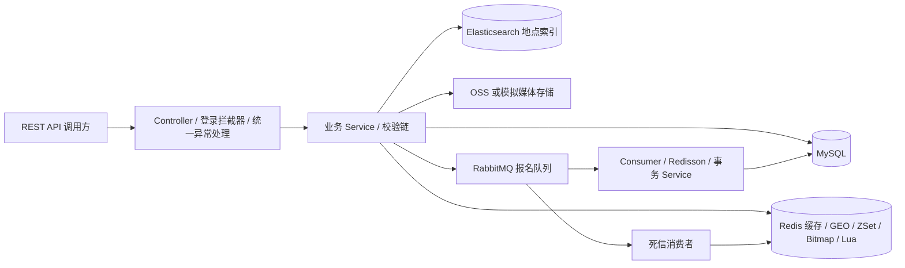

# NexusHub

NexusHub 是一个基于 Spring Boot 构建的综合生活与兴趣社区后端平台，涵盖地点发现、社区动态、用户关注、兴趣推荐及热门活动报名等核心功能。本仓库为独立 Java REST API 后端。

仓库地址：[WuJiaoHuang/NexusHub](https://github.com/WuJiaoHuang/NexusHub)。

## 1. 技术栈

| 技术 | 仓库使用版本与用途 |
| --- | --- |
| Java | 8（Maven 编译目标 1.8） |
| Spring Boot | 2.3.12.RELEASE，Web、校验、事务、AMQP |
| MyBatis-Plus | 3.4.3，Mapper、分页、条件更新 |
| MySQL | Docker 8.0，Connector/J 8.0.28 |
| Redis | Docker 6.2，缓存与原子脚本 |
| Spring Data Redis / Lettuce | 2.6.2 / 6.1.6.RELEASE |
| Redisson | 3.13.6，报名分布式锁 |
| RabbitMQ | Docker 3.12-management，异步报名、重试与死信 |
| Elasticsearch | 服务端及 High Level REST Client 7.6.2 |
| 阿里云 OSS SDK | 3.17.4，媒体上传 |
| Hutool / Lombok | 5.7.17 / 1.18.46 |
| Maven / JUnit Jupiter / H2 | 构建、单元测试、内存数据库测试；测试版本由 Boot 管理 |

本次重构保留现有依赖版本及构建插件。

## 2. 系统架构



代码根包为 `com.nexushub`，启动类为 `NexusHubApplication`，Mapper 扫描为 `com.nexushub.mapper`。领域模型包括 `Place`、`Post`、`PostComment`、`Event`、`EventCapacity`、`EventRegistration`。

## 3. 核心业务

- 用户认证：手机号验证码登录、Redis Token、个人资料、头像与兴趣标签维护、签到。
- 地点发现：详情、按名称查询、按分类分页、GEO 附近检索、组合条件搜索。
- 社区动态：发布、热门排序、详情、点赞及点赞用户列表。
- 用户关注与 Feed：关注关系、共同关注、动态推送与滚动分页。
- 活动报名：活动列表、详情、热门活动、地点关联活动、报名状态与个人报名记录。
- 兴趣推荐：标签匹配、报名热度、时效性加权排序，权重分别为 0.5、0.3、0.2，属于规则推荐。
- 媒体上传：头像、动态、地点、活动图片，支持 JPEG/PNG/WebP；头像最大 5MB，动态单图最大 10MB。

## 4. 高并发活动报名

1. `RegistrationValidationChain` 校验活动容量记录与报名时间窗口。
2. `event_registration.lua` 原子检查名额与重复报名，成功后扣减 Redis 名额并记录用户。
3. 发送 `EventRegistrationMessage` 至原有 Exchange 和 Queue，启用关联 publisher confirms 和 mandatory returns。仅在 broker 确认且没有退回消息后返回受理成功；最终落库结果仍通过状态接口查询。
4. Consumer 调用事务 Service，使用活动与用户维度的 Redisson 锁。锁获取失败或线程中断会抛出异常，交由监听容器重试及死信处理，不会直接返回并确认未落库消息。
5. 查询重复记录，**先插入报名记录，再条件扣减数据库容量**，两者处于同一事务中。唯一索引冲突或容量更新失败均回滚。
6. 监听容器按原配置重试，耗尽后进入死信队列。死信消费者先检查该报名记录是否已落库，未落库才执行 Redis 补偿。
7. `compensate_event_registration.lua` 通过 `event:registration:compensated:{registrationId}` 保证同一报名补偿幂等，标记 TTL 为 86400 秒。

数据库最终容量保护保持为：

```sql
UPDATE event_capacity
SET remaining_slots = remaining_slots - 1
WHERE event_id = ? AND remaining_slots > 0;
```

`event_registration.uk_user_event(user_id,event_id)` 防止重复记录，重投已落库消息不会再次消耗容量。Exchange、Queue、Routing Key 与原实现相同。

发送处理区分明确失败和结果不确定：发布前连接失败、序列化失败、mandatory 退回及 broker 拒绝会调用既有幂等 Lua 补偿；确认超时、连接中断或框架产生的 nack 可能已送达，保留预占并返回待确认提示。补偿失败会返回待处理并记录关联 ID，不能宣称名额已经恢复。未引入事务 Outbox，进程崩溃或投递结果不确定仍需运维核对，不能宣称消息绝对可靠。锁释放发生在方法内部，事务由代理在方法返回后提交，最终并发安全依赖数据库唯一索引及条件更新。启动预热会从 MySQL 写回 Redis 名额，因此有在途报名时不得直接重启或混跑迁移实例。补偿标记有效期为一天，超期死信回放需人工审核。本次重构保留原有事务和算法边界。

## 5. Redis 设计

| Key | 用途 |
| --- | --- |
| `login:code:{phone}` / `login:token:{token}` | 验证码与登录状态 |
| `cache:place:{id}` / `cache:place:type` | 地点详情与分类缓存 |
| `lock:place:{id}` | 热点缓存互斥重建 |
| `geo:place:type:{categoryId}` | 分类地点 GEO |
| `sign:{userId}:{yyyyMM}` | Bitmap 签到 |
| `post:liked:{postId}` | ZSet 点赞用户及时间 |
| `feed:{userId}` | ZSet Feed，score + offset 滚动分页 |
| `event:slots:{eventId}` | 报名剩余名额 |
| `event:registration:{eventId}` | 已预占名额的用户集合 |
| `event:registration:compensated:{registrationId}` | 补偿幂等标记 |

地点缓存采用 Cache Aside，更新数据库后删除缓存。策略工厂支持 `PASS_THROUGH`（默认，空值缓存防穿透）、`MUTEX`（互斥重建）和 `LOGICAL_EXPIRE`（逻辑过期）。Key 及 Lua 算法未因改名而改变。启动时 GEO 初始化读取地点并按分类构建索引。

## 6. Elasticsearch 检索

默认索引为 `nexushub_place`，可通过原变量 `PLACE_SEARCH_INDEX` 覆盖。

`GET /places/search` 支持 `keyword`、`categoryId`、`area`、`minPrice`、`maxPrice`、`minScore`、`sort`、`current`、`size`。排序值为 `score_desc`、`sold_desc`、`avgPrice_asc`、`avgPrice_desc`。关键词查询覆盖名称、描述、地址、地区。

`PlaceSearchConverter` 转换实体与文档；地点变更通过监听器在事务提交后增量同步。`POST /admin/search/places/rebuild` 批量重建，默认批次 500。搜索和同步会在索引不存在时创建 mapping。

重建会删除并重建**当前配置的目标索引**，应在维护窗口执行。迁移时配置新索引再重建，保留旧索引，参见 [数据迁移](docs/migration.md)。

## 7. 数据库设计

默认库为 `nexushub`。

| 表 | 职责与关键约束 |
| --- | --- |
| `tb_user` / `tb_user_info` | 用户与扩展资料，手机号唯一 |
| `user_interest` | 兴趣，`uk_user_interest(user_id,tag)` |
| `place_category` / `place` | 分类与地点，保留分类索引 |
| `tb_follow` | 关注，`uk_follow(user_id,follow_user_id)` |
| `post` / `post_comment` | 社区动态与评论，保留用户、点赞、地点、评论关联索引 |
| `event` | 活动地点、标签、报名窗口与容量 |
| `event_capacity` | 活动主键与剩余名额、报名窗口 |
| `event_registration` | 报名记录，`uk_user_event(user_id,event_id)` 及用户、活动索引 |

`sql/schema.sql` 仅用于空环境，不含 DROP TABLE；`sql/data.sql` 为模拟数据，包含四类地点及 Java、篮球、AI、摄影活动。容量与窗口从活动表复制，保持一致。已有数据库使用 [迁移流程](docs/migration.md) 和 `sql/migrations/001_rename_community_tables.sql`，禁止重跑初始化脚本。

## 8. Docker 部署

需要 Maven、可用 JDK（编译目标 Java 8）和 Docker Compose。Compose 启动中间件，Java 应用单独运行。

```bash
cp .env.example .env
docker compose --env-file .env config
docker compose --env-file .env up -d
docker compose ps
```

`.env` 供 Compose 替换变量，**Spring Boot 不会自动加载 `.env`**。Java 进程也需导入这些变量。以下为 Bash 的全新本机环境示例：

```bash
set -a
. ./.env
set +a
mvn clean package
java -jar target/nexushub-0.0.1-SNAPSHOT.jar
```

PowerShell 可逐项设置 `$env:DB_PORT='13306'` 等变量，或参考 `src/main/resources/application-local.yml.example` 创建不提交 Git 的本地配置并启用 `local` profile。默认 HTTP 端口为 8080。

| 中间件 | 容器名 | 默认宿主机端口 |
| --- | --- | --- |
| MySQL 8.0 | `nexushub-mysql` | 13306 |
| Redis 6.2 | `nexushub-redis` | 16379 |
| RabbitMQ 3.12 | `nexushub-rabbitmq` | AMQP 5673，管理 15673 |
| Elasticsearch 7.6.2 | `nexushub-elasticsearch` | 19200 |
## 9. 接口文档

请求字段、JSON 响应和 URL 保持现有契约。统一 `Result` 响应含 `success`、`errorMsg`、`data`、`total`。登录后在 `authorization` 请求头中直接传 token。

| 方法与路径 | 用途 |
| --- | --- |
| `POST /auth/code?phone=...` / `POST /auth/login` | 验证码与登录，保留 `/users` 别名 |
| `GET /users/me`、`PUT /users/profile`、`PUT /users/avatar` | 当前用户与资料 |
| `GET/PUT /users/interests`、`POST /users/sign`、`GET /users/sign/count` | 兴趣与签到 |
| `GET /place-categories/list` | 地点分类 |
| `GET /places/{id}`、`POST /places`、`PUT /places` | 地点详情、新增、更新 |
| `GET /places/nearby?categoryId=1&current=1&x=120.15&y=30.28` | 附近地点，不传坐标时按分类分页 |
| `GET /places/of/name`、`GET /places/search` | 名称查询与 ES 搜索 |
| `POST /posts`、`GET /posts/{id}`、`GET /posts/hot` | 社区动态 |
| `PUT /posts/like/{id}`、`GET /posts/likes/{id}` | 点赞与点赞列表 |
| `GET /posts/of/me`、`GET /posts/of/user?id=...` | 用户动态 |
| `GET /feeds?lastId=...&offset=0` | 关注 Feed，保留 `/posts/feeds` |
| `PUT /follows/{id}/{isFollow}`、`GET /follows/or/not/{id}`、`GET /follows/common/{id}` | 关注与共同关注 |
| `GET /events`、`GET /events/{id}`、`POST /events` | 活动列表、详情、创建 |
| `GET /events/hot`、`GET /events/by-place/{placeId}`、`GET /events/recommendations` | 热门、地点活动、推荐 |
| `POST /events/{eventId}/registrations`、`POST /event-registrations/{eventId}` | 异步报名 |
| `GET /events/{eventId}/registrations/status`、`GET /event-registrations/me` | 报名结果与记录 |
| `POST /uploads/image` | multipart `file`、`scene`；当前用户可用 AVATAR/POST，PLACE/EVENT 保留权限限制 |
| `POST /admin/search/places/rebuild` | 当前配置的地点索引重建 |


## 10. 项目技术亮点

- Redis Lua 原子预占、RabbitMQ 异步处理、Redisson 锁、MySQL 唯一约束和条件扣减保护活动报名。
- 可替换缓存策略处理缓存穿透与热点重建，保留 Cache Aside 更新流程。
- GEO 附近检索、Bitmap 签到、ZSet 点赞与滚动 Feed。
- Elasticsearch 组合检索、事务提交后增量同步与批量重建。
- H2 测试验证 Mapper、报名幂等和事务回滚，独立脚本区分初始化与数据迁移。

